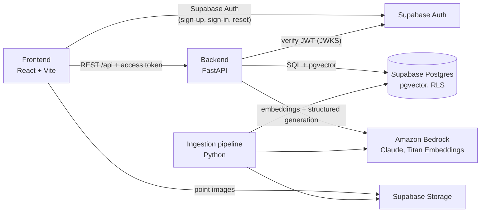

# acupuncture·points — Acupressure Recommendation App

A responsive web app that helps people explore acupressure points for a physical or mental/emotional symptom. The user describes the symptom in their own words. An AI-assisted workflow interprets it, retrieves curated knowledge, and returns three acupressure points with a location picture (or a text description), step-by-step instructions, and duration/pressure guidance where the curated source provides it. Users rate each point after trying it, and those ratings act as a secondary ranking signal.

Requirements live in [`_docs/specification.md`](_docs/specification.md). Work is tracked as [GitHub issues](https://github.com/TOmelchenko/AcupuncturePoints/issues).

> **Medical disclaimer.** This app provides general wellness information only. It does not diagnose, it is not an emergency or treatment service, and it does not replace professional medical care. Stop any technique that causes pain or discomfort, and seek professional advice if you are concerned about a symptom.

## Known limitations

- **General disclaimer only.** There is deliberately no automated safety screening or medical triage. The disclaimer does not make every suggestion safe for every person.
- **Quality depends on the sources.** Recommendations are only as good as the curated material. The repository ships with *invented development data* (`db/seed/`), not a real knowledge base; the project owner selects the real sources.
- **Grounding reduces but cannot remove errors.** Retrieval, schema validation and point-ID checks stop the model from inventing points, images, durations or pressure guidance. They cannot guarantee that every instruction is accurate or appropriate.
- **No efficacy claims.** The app makes no claim that acupressure treats any condition.
- **Sparse ratings early on.** Ratings only nudge the ranking (±0.05 relevance, at least 3 ratings), so recommendations stay driven by symptom relevance.
- **Sensitive data.** Symptom descriptions may contain health information. They are visible only to their owner (RLS), never logged, and deleted with the account.

## Architecture



How a recommendation request works (`backend/app/recommender.py`):

1. **Store the attempt.** The backend verifies the Supabase access token and stores the attempt with the original symptom text.
2. **Interpret.** Claude maps the symptom to predefined categories and search terms, or asks a clarifying question.
3. **Retrieve.** Candidates come from two sources: points curated for the matched categories, and points linked to the most similar knowledge chunks found with a `pgvector` cosine search.
4. **Rank.** Candidates are ordered by relevance, with past ratings as a bounded tie-breaker.
5. **Choose.** Claude picks three of the candidates, grounded in the retrieved excerpts.
6. **Validate.** The backend checks there are exactly three distinct IDs, all among the candidates and all present in the database. Everything the user sees comes from the curated database records.
7. **Persist and return.** The outcome is stored (`recommended`, `clarification_needed`, `no_match` or `failed`) and returned.

| Path | Contents |
|---|---|
| `frontend/` | React + TypeScript + Vite, Tailwind v4 + shadcn/ui (design from the pressure·point prototype), TanStack Query, React Hook Form + Zod, Vitest, Playwright (`e2e/`) |
| `backend/` | FastAPI app (`app/`), pytest suite (`tests/`, database tests in `tests/db/`) |
| `ingestion/` | Text extraction with OCR, translation, chunking, embeddings, image catalogue |
| `db/` | Plain SQL setup scripts (schema, RLS, storage) and development seed data |
| `tests/integration/` | Integration tests against a running backend and local Supabase |
| `supabase/` | Local Supabase CLI configuration |
| `_docs/` | Specification, process, roles, [AI-assisted workflow](_docs/ai-workflow.md) |

The API is documented by FastAPI's OpenAPI: http://localhost:8000/docs (interactive) and `/openapi.json`.

## Quick start (local)

**Prerequisites:** Docker, Node.js 22, [uv](https://docs.astral.sh/uv/), `psql` (PostgreSQL client), and Tesseract if you run ingestion on scanned PDFs.

```sh
make install          # backend, frontend, ingestion and integration-test dependencies
make supabase-start   # local Supabase in Docker (first run downloads images)
make supabase-env     # create .env from .env.example and fill in the local Supabase keys
make db-setup         # apply db/ scripts: schema, RLS policies, storage bucket
make db-seed          # invented development data (local only)
```

Choose the AI provider in `.env`:
- **Offline demo:** `AI_PROVIDER=fake` uses keyword-matching stand-in answers, with no AWS needed.
- **Real AI:** `AI_PROVIDER=bedrock` uses AWS credentials and Bedrock model access in `AWS_REGION`.

Then start the app:

```sh
make up               # backend on http://localhost:8000, frontend on http://localhost:5173
```

Open http://localhost:5173, create an account, and confirm it with the email caught by Mailpit at http://127.0.0.1:54324. Supabase Studio is at http://127.0.0.1:54323.

Without Docker Compose you can also run the two apps directly: `cd backend && uv run uvicorn app.main:app --reload` and `cd frontend && npm run dev`.

## Configuration

All configuration comes from environment variables. Copy `.env.example` to `.env` (`make env` does this) and never commit `.env`. CI and CD credentials live in GitHub Actions Secrets.

| Variable | Used by | Purpose |
|---|---|---|
| `SUPABASE_URL` | backend | Supabase project URL; access tokens are verified against its JWKS |
| `SUPABASE_PUBLIC_URL` | backend | Browser-facing Supabase URL for Storage image links (defaults to `SUPABASE_URL`) |
| `SUPABASE_SERVICE_ROLE_KEY` | backend, ingestion | Privileged key for deleting Auth users and uploading images. **Backend only.** |
| `DATABASE_URL` | backend, ingestion, `make db-*` | Postgres connection string (privileged; the backend scopes private data to the user) |
| `AI_PROVIDER` | backend, ingestion | `bedrock` (default) or `fake` (offline demo; never production) |
| `AWS_REGION`, `AWS_ACCESS_KEY_ID`, `AWS_SECRET_ACCESS_KEY` | backend, ingestion | Bedrock access (or any standard AWS credential source) |
| `BEDROCK_TEXT_MODEL_ID` | backend, ingestion | Claude model, default `anthropic.claude-opus-5-5` |
| `BEDROCK_EMBEDDING_MODEL_ID` | backend, ingestion | Default `amazon.titan-embed-text-v2:0`; must match the `vector(1024)` column |
| `LOG_LEVEL` | backend | Default `INFO` |
| `VITE_SUPABASE_URL`, `VITE_SUPABASE_ANON_KEY` | frontend | Public values bundled into the browser app (RLS protects the data) |
| `VITE_API_BASE_URL` | frontend | Backend URL; leave empty locally (Vite proxies `/api`) |
| `COMPOSE_SUPABASE_URL`, `COMPOSE_DATABASE_URL` | Docker Compose | Override how the backend container reaches Supabase (defaults to the host's local Supabase) |

## Commands

| Command | What it does |
|---|---|
| `make install` | Install all dependencies |
| `make up` / `make down` / `make logs` | Start, stop and follow the Docker Compose environment |
| `make supabase-start` / `make supabase-stop` | Start or stop local Supabase |
| `make supabase-env` | Write the local Supabase URL and keys into `.env` |
| `make db-setup` | Apply the SQL scripts in `db/` (idempotent; works on hosted Supabase via `DATABASE_URL`) |
| `make db-seed` / `make db-reset` | Load development data / recreate the local database (local only) |
| `make test` | Backend, frontend and ingestion tests |
| `make test-integration` | Integration tests (running backend + local Supabase) |
| `make e2e` | Playwright browser tests |
| `make lint` | ruff, mypy and ESLint (with TypeScript type-check in the build) |
| `make security` | pip-audit, npm audit and gitleaks secret detection |

## Testing

| Layer | Where | Notes |
|---|---|---|
| Backend unit and API tests | `backend/tests/` | Bedrock is always mocked (`FakeAI`). Database tests in `tests/db/` run against local Supabase and are skipped when it isn't running; CI sets `REQUIRE_DB=1` so they fail instead. |
| Frontend component tests | `frontend/src/**/*.test.tsx` | Vitest + React Testing Library: forms, loading, clarification, no-match, error/retry, cards (image vs. text fallback, omitted guidance), ratings, account settings |
| Ingestion tests | `ingestion/tests/` | Includes a real OCR test on a generated scanned page |
| Integration tests | `tests/integration/` | Backend as a separate process, real Supabase Auth tokens, RLS checked through Supabase's REST API |
| Browser tests | `frontend/e2e/` | Playwright, desktop and mobile. Registration with a real confirmation email from Mailpit. |
| Live AI smoke test | `backend/tests/test_ai.py` | Opt-in only (`RUN_LIVE_AI=1`). Makes two small billable Bedrock calls. |

The demo AI understands two markers for exercising failure paths: a symptom containing `[demo:fail]` makes the AI call fail, and `[demo:invalid-id]` makes the model return a point ID that doesn't exist.

GitHub Actions (`.github/workflows/ci.yml`) runs on every pull request and every push to `main`:
- frontend lint, tests and build
- backend lint, type-check and tests against local Supabase
- ingestion checks
- integration tests
- Playwright tests
- Docker image builds
- dependency audits and secret detection

## Database

The schema, RLS policies and storage bucket are plain SQL scripts in `db/`, applied in file-name order. There is deliberately no migration framework. All scripts are idempotent.

- **Curated content** (`points`, `symptom_categories`, `point_categories`, `sources`, `knowledge_chunks`): readable by signed-in users, writable only by privileged connections.
- **User data** (`recommendation_attempts`, `recommendation_points`, `point_ratings`): each user can read only their own rows. Users can't write through the Supabase API; the backend validates and writes for them. All of it cascades from `auth.users`, so deleting an account removes it.
- **Hosted Supabase:** set `DATABASE_URL` to the project's connection string (Dashboard → Connect) and run `make db-setup`.

## Knowledge ingestion

`ingestion/` turns curated source documents into the knowledge base. Run it from `ingestion/`. `sources/` and `out/` are git-ignored. Run the steps in this order, because chunks can only be linked to points that already exist.

**Current sources:**
- The [meine-tcm.com acupuncture point atlas](https://www.meine-tcm.com/en/atlas-of-acupuncture-points/) supplies the curated points: location, symptoms, acupressure steps, duration and pressure.
- The WHO *Standard Acupuncture Point Locations* (`infosource/`, pages 34–241) adds location text for all 361 points.

meine-tcm.com gave permission (November 2026) to use its text and point pictures in this non-commercial project, credited "Image: meine-tcm.com".

1. **Curated points from the web atlas.** `ingestion.web` downloads the point pages and location pictures once into `sources/web/meine-tcm/` (re-runs use the saved copies; `--refresh` downloads again). It writes `points.json`, plus `images.json` for step 4. `ingestion.points` then:
   - upserts each point (name, location, instructions, duration, pressure). A pregnancy contraindication is added as the last instruction.
   - maps each point's "helps with" symptoms to the self-care categories defined in `ingestion/points.py`. Serious conditions such as hypertension are deliberately not mapped.
   - stores one chunk per point, linked to that point.

   Existing images are kept, and re-running replaces the category links and chunks.

   ```sh
   uv run python -m ingestion.web sources/web/meine-tcm
   uv run python -m ingestion.points sources/web/meine-tcm/points.json
   SUPABASE_URL=... SUPABASE_SERVICE_ROLE_KEY=... uv run python -m ingestion.images sources/web/meine-tcm/images.json
   ```

2. **Extract text** from local PDF, `.txt` or `.md` files listed in a JSON manifest. Each page's text is cleaned; pages with no text layer are read with Tesseract OCR using the source language.

   ```sh
   uv run python -m ingestion.extract sources/manifest.json -o out/pages.jsonl
   ```
   ```json
   {"sources": [{"file": "guide.pdf", "title": "Guide title", "language": "en",
                 "author": "Author", "url": "https://...", "license": "CC BY 4.0",
                 "pages": "34-241", "drop_lines": ["^Stomach Meridian\\s*\\d+$"], "use_ocr": false}]}
   ```

   Optional fields:
   - `pages` limits extraction to a page range.
   - `drop_lines` lists regular expressions for running headers to remove.
   - `use_ocr: false` skips OCR, e.g. on pages that hold only diagrams.

   Page numbers and figure labels (lines holding only point codes) are always dropped. A point entry such as `ST21: Liangmen` starts a new paragraph.

3. **Translate, chunk, embed and store.**
   - Non-English pages are translated into English with Claude; the source keeps its original language and page references.
   - Text is split into ~1,000-character overlapping chunks. A new chunk starts at each point heading.
   - Each chunk is embedded with Titan Text Embeddings V2.
   - Chunks are stored in `knowledge_chunks`. A chunk is linked to a known point when it is headed by that point's code, or otherwise when it mentions exactly one known code. Codes are normalised first, so `Li 04`, `LI-4` and `LI4` all count as `LI4`, and `TB`/`SJ`/`LV`/`Pe` become `TE`/`LR`/`PC`.
   - Re-running a source replaces its chunks.

   ```sh
   uv run python -m ingestion.load out/pages.jsonl
   ```

4. **Catalogue point images** by hand. Each image has an explicit `permitted` decision plus its attribution and licence. Permitted images are uploaded to the public `point-images` bucket and linked to their point; `"permitted": false` clears any existing image, so the app shows the text location instead. Only use images whose licence allows it.

   ```sh
   SUPABASE_URL=... SUPABASE_SERVICE_ROLE_KEY=... uv run python -m ingestion.images sources/images.json
   ```
   ```json
   {"images": [{"point_id": "LI4", "file": "images/li4.png", "permitted": true,
                "attribution": "Figure 3, A. Author", "license": "CC BY 4.0",
                "source_title": "Guide title", "page": 12}]}
   ```

## Errors, logging and privacy

- **One error shape.** Every API error looks like `{"error": {"code", "message", "retryable"}}`, with a generic message that's safe to show. Stack traces, provider errors, prompts and request IDs never appear in responses.
- **Failures are retryable and recorded.** AI or technical failures return `502 recommendation_failed` with `retryable: true`, and the attempt is stored as `failed`.
- **Logs** record attempt IDs, outcomes and error classes. Symptom text is never logged. Unexpected exceptions are logged with their class and stack frames but not their message, because messages can echo stored values.
- **Secrets stay off the frontend.** AWS credentials and the Supabase service-role key exist only on the backend.

## Troubleshooting

| Symptom | Fix |
|---|---|
| Frontend shows "VITE_SUPABASE_URL and VITE_SUPABASE_ANON_KEY must be set" | Run `make supabase-env` (local) or fill both values in `.env`, then restart Vite/Compose |
| Every API call returns 401 | The backend's `SUPABASE_URL` must point at the same Supabase project that issued the token. Inside Docker, the backend uses `host.docker.internal` by default. |
| Recommendations always fail with "Something went wrong" | Check the backend logs. With `AI_PROVIDER=bedrock` you need AWS credentials and model access in `AWS_REGION`. Use `AI_PROVIDER=fake` to work offline. |
| Images don't load | Run `make db-seed` (local) so the dev images are uploaded. The browser must reach `SUPABASE_PUBLIC_URL`. |
| No confirmation email | Local emails go to Mailpit at http://127.0.0.1:54324. Hosted projects need SMTP configured in Supabase. |
| Database tests are skipped | Start local Supabase (`make supabase-start db-setup`). Set `REQUIRE_DB=1` to make them fail instead. |
| `make db-seed` refuses to run | It only runs against a local `DATABASE_URL`, by design. |

## Deployment

The MVP deploys to free tiers: **Supabase Free** for the database, Auth and Storage, and **Render** for the backend (Docker web service) and frontend (static site), in separate development and production environments. Amazon Bedrock runs Claude Haiku 4.5 in the deployed environments. All of this is defined in `render.yaml`.

- **Development:** deploys automatically after CI passes on `main` (`.github/workflows/deploy-dev.yml`).
- **Production:** deploys manually with approval, and only a commit already verified in development can go (`.github/workflows/deploy-prod.yml`).
- **Safety:** a failed deploy never replaces the running version. Rollback means redeploying the last good commit.

Setup steps, the release process and rollback are in [`_docs/deployment.md`](_docs/deployment.md).

| Environment | URL |
|---|---|
| Development | *added after the first deployment* |
| Production | *added after the first deployment* |

## AI-assisted development

The project was built with coding agents following [`AGENTS.md`](AGENTS.md), [`_docs/process.md`](_docs/process.md) and the roles in [`_docs/roles/`](_docs/roles/). See [`_docs/ai-workflow.md`](_docs/ai-workflow.md) for the workflow, prompts, context files, review and verification steps.
